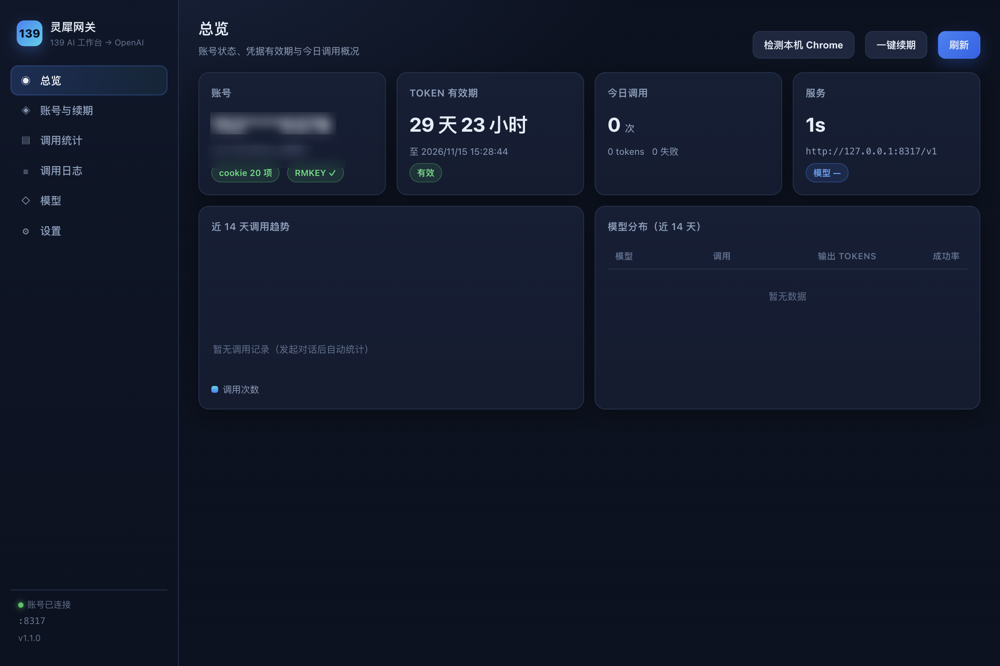
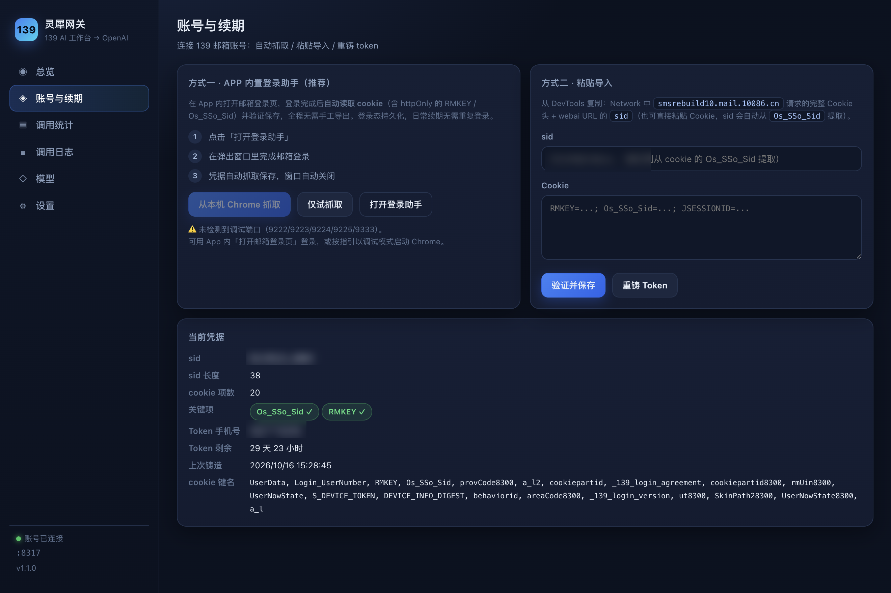
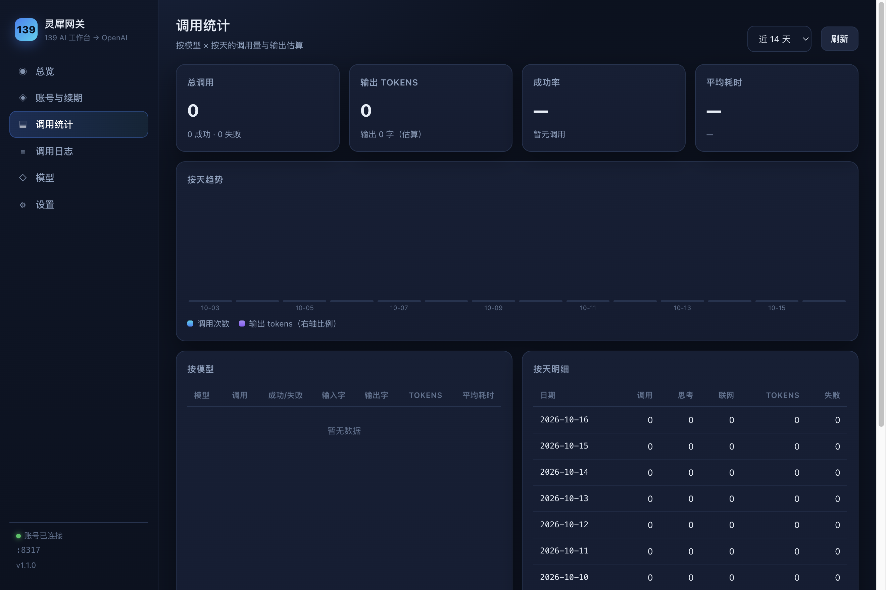
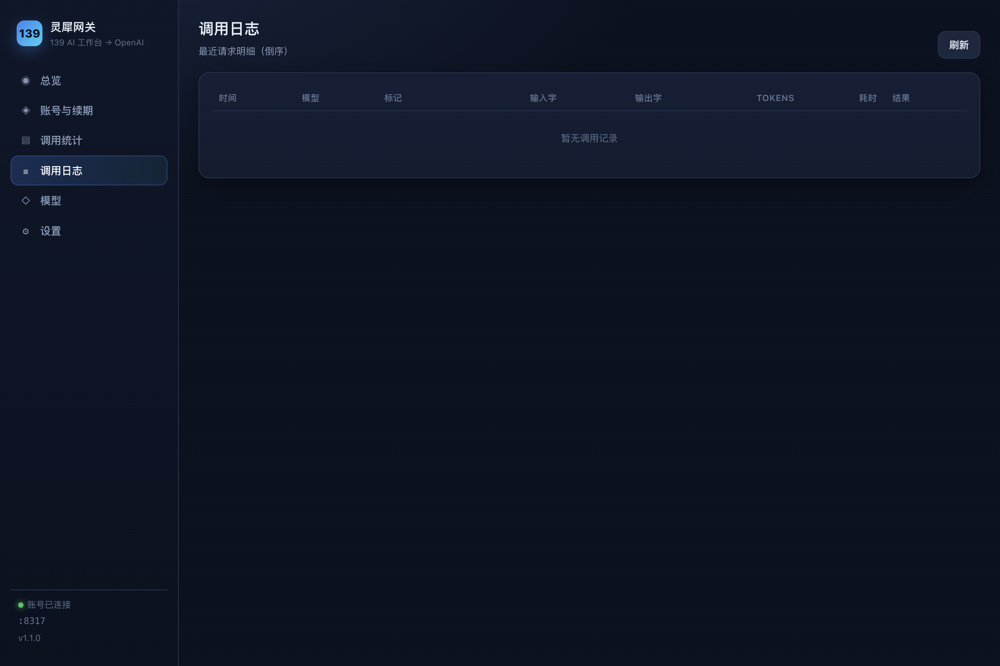

# 灵犀网关 · Lingxi Gateway

> 把 **139 邮箱 AI 工作台（灵犀 / MClaw）** 的免费大模型反代成标准 **OpenAI 兼容 API**，并附带一个桌面控制台：连接账号、自动续期、查看各模型调用量。

[](LICENSE)
[](https://www.electronjs.org/)
[](https://nodejs.org/)

```
OpenBitFun / OpenAI SDK / Claude Code / Cherry Studio …
                    │  OpenAI 协议
                    ▼
        灵犀网关（本地 127.0.0.1:8317）
                    │  逆向协议
                    ▼
   ai.yun.139.com（139 AI 中台）── 10 个免费模型，qwen 系 800k 上下文
```

---

## ✨ 功能特性

| 能力 | 说明 |
|---|---|
| 🔌 **OpenAI 全兼容** | `/v1/models`、`/v1/chat/completions`（流式 / 非流式），任意支持自定义 Base URL 的客户端直接接入 |
| 🧠 **深度思考** | 自动归一化 `enable_thinking` / `thinking:{type}` / `reasoning_effort` 三种客户端风格，思考流映射为 `delta.reasoning_content` |
| 🛠 **工具调用（function calling）** | 139 上游无原生支持 → 网关以 qwen HERMES 文本协议模拟，含流式状态机（跨 chunk 标签、未转义引号抢救、多余闭合标签剥离），Agent 场景可直接跑 |
| 📊 **TPS / 用量上报** | 流式响应无条件携带 `usage` 块，客户端（如 OpenBitFun）可直接显示 token 用量、输出速度与**缓存命中率**（上游不提供计量，网关按前缀复用估算并标记来源） |
| 👤 **账号连接** | 桌面版内置登录助手：App 内登录 139 邮箱 → 自动读取 httpOnly cookie → 验证铸造 → 保存，**无需手工导出凭据** |
| ♻️ **自动续期** | Token 约 25 天有效，到期前 1 天自动重铸；支持一键手动续期与会话过期提醒 |
| 📈 **调用统计** | 按模型 × 按天的调用量、输入/输出字数、估算 tokens、平均耗时、成功率；近 7/14/30/90 天趋势 |
| 🪶 **零运行时依赖** | 网关主体是纯 Node 18+ ESM（无 npm 依赖），可直接 `node gateway/server.mjs` 运行 |

---

## 📸 界面预览

| 总览 | 账号与续期 |
|---|---|
|  |  |

| 调用统计 | 调用日志 |
|---|---|
|  |  |

---

## 🚀 快速开始

### 方式一：下载安装包（推荐普通用户）

从 [Releases](../../releases) 下载对应平台（安装后应用名为「灵犀网关」）：

| 平台 | 文件 | 说明 |
|---|---|---|
| macOS（Apple Silicon / M 系列） | `LingxiGateway-<版本>-mac-arm64.dmg` | 打开 dmg 拖入「应用程序」 |
| macOS（Intel） | `LingxiGateway-<版本>-mac-x64.dmg` | 同上 |
| Windows（x64） | `LingxiGateway-<版本>-win-x64-setup.exe` | 安装向导，可选安装目录 |
| Windows（便携） | `LingxiGateway-<版本>-win-x64.zip` | 解压双击 `LingxiGateway.exe`，免安装 |

> **macOS 首次打开提示「已损坏」或「无法验证开发者」？** 这是 Gatekeeper 对**未经 Apple 公证**应用的通用提示（不代表文件真的损坏，产物本身是有效的 ad-hoc 签名）。任选其一解除：
> - **推荐**终端执行：`xattr -dr com.apple.quarantine /Applications/灵犀网关.app`
> - 或右键点击 App → **打开** → 弹窗里再点「打开」
>
> 解除后即可长期正常启动（应用签名有效，无需重复操作）。
>
> **Windows SmartScreen 提示？** 点击「更多信息」→「仍要运行」。

启动后 App 会自动监听 `127.0.0.1:8317` 并在窗口中打开控制台。

### 方式二：源码运行

```bash
git clone https://github.com/chaos-cl/lingxi-gateway.git
cd lingxi-gateway

# A. 桌面控制台（Electron，推荐）
npm install          # 国内可加 --registry=https://registry.npmmirror.com
npm start

# B. 纯 CLI 网关（零依赖，无 GUI）
node gateway/server.mjs
# 然后浏览器打开 http://127.0.0.1:8317/admin 使用完整控制台
```

> CLI 模式与桌面版共用同一套网关实现（`gateway/app.mjs`），**两者不要同时启动**（端口冲突）。

---

## 👤 连接账号（首次必做）

网关需要一份 139 邮箱登录凭据才能调用上游模型。三种方式，任选其一：

### 方式 A：App 内置登录助手（桌面版，最省事）

1. 打开控制台 → **账号与续期** → 点「**打开登录助手**」
2. 在弹出窗口中完成 139 邮箱登录（账号密码 / 短信）
3. 登录成功后，App **自动读取 cookie**（含 httpOnly 的 `RMKEY`、`Os_SSo_Sid`）→ 验证铸造 → 保存，窗口自动关闭

登录态使用独立持久化分区保存，**后续续期无需重复登录**。

### 方式 B：从本机 Chrome 抓取

适用于你日常在 Chrome 里就登录着 139 邮箱：

```bash
# 以调试模式启动 Chrome（先完全退出 Chrome）
/Applications/Google\ Chrome.app/Contents/MacOS/Google\ Chrome --remote-debugging-port=9222

# Windows:
"C:\Program Files\Google\Chrome\Application\chrome.exe" --remote-debugging-port=9222
```

然后在控制台点「**从本机 Chrome 抓取**」。（可先点「仅试抓取」验证，不会写入）

### 方式 C：粘贴导入

1. 浏览器登录 <https://mail.10086.cn>
2. F12 → Network → 找任意发往 `smsrebuild10.mail.10086.cn` 的请求 → 复制**完整 Cookie 请求头**
3. 在控制台「方式二 · 粘贴导入」中粘贴 Cookie（`sid` 可留空，会自动从 `Os_SSo_Sid` 提取）
4. 点「验证并保存」——**只有验证铸造成功才会写入**

凭据保存位置（权限 600，仅在本地）：

| 运行方式 | 路径 |
|---|---|
| CLI | `gateway/credentials.json` |
| 桌面版 | `~/Library/Application Support/灵犀网关/credentials.json`（macOS）<br>`%APPDATA%\灵犀网关\credentials.json`（Windows） |

> ⚠️ **切勿把 `credentials.json` 提交到任何仓库或分享给他人**，它等同于你的邮箱登录态。

---

## ♻️ 账号续期

| 凭据 | 有效期 | 网关处理 |
|---|---|---|
| RCS Token（Basic 认证用） | 约 25 天 | **落盘缓存**在 `data/token.json`，到期前 1 天自动重铸；控制台也可手动「重铸 Token」 |
| 邮箱会话（sid + cookie） | 浏览器会话级，会随会话轮换 | 只在**铸造 Token 那一刻**需要新鲜 cookie；过期后上游返回 `FA_INVALID_SESSION`，需重新连接账号（方式 A/B/C） |

> **为什么 Token 要落盘**：铸造接口要求 sid 对应 cookie 是"新鲜"的（浏览器关掉/久不用就失效），而铸出来的 Token 有约 25 天有效期。网关把 Token 写进 `data/token.json` 复用，**因此重启网关/App 不需要重新登录**；只有在 Token 过期、或你换了账号时才需要回浏览器取一次 cookie。

控制台「总览」页的 **Token 有效期倒计时** 可随时查看剩余时间。

---

## 🔌 接入你的 AI 客户端

Base URL 固定为 `http://127.0.0.1:8317/v1`，API Key 任意填（除非在「设置」里配置了网关鉴权）。

### OpenBitFun

添加自定义模型（Provider 选 `openai`）：

| 字段 | 值 |
|---|---|
| Base URL | `http://127.0.0.1:8317/v1` |
| API Key | 任意（如 `1234`） |
| 模型 | `blian_qwen38_max` / `blian_qwen38_flash` 等（见下表） |
| 上下文窗口 | qwen 系填 `800000` |

深度思考、TPS 用量、工具调用均已适配，无需额外配置。

### OpenAI SDK

```python
from openai import OpenAI

client = OpenAI(base_url="http://127.0.0.1:8317/v1", api_key="any")

stream = client.chat.completions.create(
    model="blian_qwen38_flash",
    messages=[{"role": "user", "content": "用一句话解释量子纠缠"}],
    stream=True,
    extra_body={"thinking": {"type": "enabled"}},   # 开启深度思考（可选）
)
for chunk in stream:
    d = chunk.choices[0].delta
    if getattr(d, "reasoning_content", None):
        print("[思考]", d.reasoning_content, end="")
    if d.content:
        print(d.content, end="")
```

### Claude Code / 其他 Agent

```bash
export OPENAI_BASE_URL=http://127.0.0.1:8317/v1
export OPENAI_API_KEY=any
```

支持 `tools` 工具调用（网关自动做协议模拟），Agent 可直接使用文件读写、命令执行等工具。

### 可用模型

| 模型 ID | 显示名 | 输入上限 | 深度思考 |
|---|---|---|---|
| `blian_qwen38_max` | qwen3.8-Max | 800k 字符 | ✓ |
| `blian_qwen38_flash` | qwen3.8-Flash | 800k 字符 | ✓ |
| `blian_qwen37_plus` | qwen3.7-Plus | 800k 字符 | ✓ |
| `blian_qwen36_plus` | qwen3.6-Plus | 800k 字符 | ✓ |
| `blian_qwen35_plus` | qwen3.5-Plus | 800k 字符 | ✓ |
| `huoshan_glm_5_3` | GLM-5.3 | 40k 字符 | 始终思考 |
| `blian_deepseek_v4_pro` | DeepSeek-V4-Pro | 40k 字符 | ✓ |
| `blian_deepseek_v4_flash` | DeepSeek-V4-Flash | 40k 字符 | ✓ |
| `jiutian` | 九天大模型 | 9k 字符 | ✗ |
| `vlm_huoshan_2_0_lite_thinking_vision` | Seed-2.0-Lite（视觉） | 40k 字符 | ✓ |

模型名也接受显示名与常用写法（`glm-5.3`、`qwen3.8-max`、`deepseek-v4-pro` 等）。

> 实测 decode 速度（剔除首包耗时）：qwen 系约 **50~90 tok/s**，GLM-5.3 / DeepSeek-V4-Flash 约 **90~150 tok/s**；首包延迟约 3~4.5 秒。

---

## 🧩 扩展参数（非 OpenAI 标准，均可省略）

| 参数 | 类型 | 作用 |
|---|---|---|
| `thinking` / `enable_thinking` / `reasoning_effort` | bool / object / string | 开启深度思考（三种客户端风格自动归一化） |
| `web_search` | bool | 联网搜索，引用列表随流返回在 `x_citations` 字段 |
| `session_id` 或请求头 `x-139-session-id` | string | 会话复用模式：只发最新一条消息，多轮上下文由 139 服务端保持（省 token、原生多轮） |

响应中的 `x_139` 字段（结束块）附带 `session_id`、`model_used`、`statement`、`citations` 等元信息。

---

## 🔍 工作原理

### 认证链路

```
邮箱 sid + cookie ──POST queryUserToken──▶ RCS Token（约 25 天）
                                              │  DES 解密手机号
                                              ▼
                      Authorization: Basic base64("mobile:手机号:RCS Token")
                                              ▼
                                 ai.yun.139.com/api/outer/assistant/*
```

逆向细节（含抓包与无头验证记录）见 [`139邮箱AI工作台API分析与封装方案.md`](139邮箱AI工作台API分析与封装方案.md)。

### 两个关键工程问题

**1. 模型是账号级全局状态** — 上游通过 `POST /chat/config` 切换模型，同一账号并发使用不同模型会互相覆盖。网关用互斥锁保护「切模型 → 对话首包」临界区，首包到达后立刻释放。

**2. 上游无 function calling** — 网关在请求侧把 `tools` 数组渲染为 qwen HERMES 风格的工具说明注入对话；响应侧用流式状态机把模型输出转回标准 `delta.tool_calls`。

实际观测到模型会用**三种方言**输出工具调用，网关全部兼容（同一块内多个并行调用也支持）：

| 方言 | 形态 |
|---|---|
| JSON | `<tool_call>{"name": "Edit", "arguments": {...}}</tool_call>` |
| HERMES XML | `<tool_call><function=Read><parameter=path>/a.txt</parameter></function></tool_call>` |
| invoke XML | `<tool_call><invoke name="Edit"><parameter name="file_path">…</parameter></tool_call>`（常缺 `</invoke>`） |

同时处理了这些边界情况：

- 跨 chunk 标签切断、未转义引号（shell 命令常见）、多余闭合标签
- **宽松 JSON**：字符串里的裸换行 / Tab、尾随逗号（模型写多行代码时常见）
- **中文标点修复**：模型会写出 `"domain": “browser”`（弯引号）或全角 `：，`，网关按"结构位置"判定后转成 ASCII，**不会破坏正文里的中文引号**
- **失败留档**：解析失败的原始块自动存到 `data/failed-toolcalls/`（保留最近 20 份），事后可查究竟是哪种畸形
- **畸形工具名归一**：模型会输出 `{"name": "tool_call", "arguments": {"name": "tools__Read", ...}}` 或 `tools__CallDeferredTool`，网关会剥掉包装层、去命名空间前缀、按本次请求的工具清单做大小写/后缀匹配，避免客户端报 `Tool 'xxx' is not in the allowed list`
- **诊断提示区分两种失败**：块已闭合但不合法 → `[网关] 工具调用解析失败（工具名）…`；块没有闭合标签 → `[网关] 工具调用被截断（工具名）…`

回归自测：`node tests/tool-calls.test.mjs`（28 项，样本取自真实会话日志）。

---

## ❓ 常见问题

<details>
<summary><b>端口 8317 被占用 / 客户端连不上</b></summary>

CLI 与桌面版互斥。先结束已有进程：

```bash
# macOS / Linux
kill $(lsof -nP -tiTCP:8317 -sTCP:LISTEN)

# Windows（PowerShell）
Get-NetTCPConnection -LocalPort 8317 | Select-Object OwningProcess
```
</details>

<details>
<summary><b>控制台提示「邮箱会话已过期（FA_INVALID_SESSION）」</b></summary>

邮箱登录会话（sid）失效，需要重新连接账号：用「登录助手」重新登录一次即可，Token 会自动重铸。

注意：已缓存的 Token 有效期内（约 25 天）**不影响正在运行的网关**，所以可能表现为「重启前一直好好的，一重启就报会话过期」——本质是 sid 早已不能铸造新 Token 了，重启后必须重新登录一次。
</details>

<details>
<summary><b>工具调用没有执行 / 正文里冒出 &lt;tool_call&gt; 标签</b></summary>

先确认网关版本 ≥ v1.1.4（旧版只认 JSON 方言，模型改用 HERMES/invoke 方言时会漏成正文）。升级后跑一次自测：

```bash
node tests/tool-calls.test.mjs
```
</details>

<details>
<summary><b>正文出现「[网关] 工具调用解析失败 / 被截断」</b></summary>

两种提示的含义不同：

- **解析失败**：模型给出的块是完整的，但内容不是合法 JSON/XML（多为引号/换行没转义）。网关会回一句带工具名和开头片段的提示，模型下一轮通常会自己改对。
- **被截断**：块没有收到 `</tool_call>`，流就结束了。

**上游其实没有很小的输出上限**（实测，qwen3.8-Flash 单次响应）：

| 场景 | 结果 |
|---|---|
| 连续数字 1..2000 | 8,898 字符，完整 |
| 填充行 500 行 | 13,397 字符，完整 |
| 填充行 1500 行 | **40,898 字符，完整** |
| `Write` 工具单次 payload（400 行 HTML/CSS） | **11,360 字符，完整落盘** |
| 要求 2500 行 | 只写 100 行就自停（`finish=stop`，模型自行收尾，非截断） |

即：真实发生过的大 payload 截断属于偶发（长流中途断），不是固定字符上限。若频繁出现，再考虑在系统提示里要求每次写入 ≤6000 字符、分段追加。
</details>

<details>
<summary><b>思考过程不显示 / TPS 不显示</b></summary>

思考需要所选模型支持（见模型表）且客户端正确解析 `delta.reasoning_content`；TPS 依赖流内 `usage` 块，网关已无条件发送，若客户端仍不显示请检查其是否基于 `usage.completion_tokens` 计算。
</details>

<details>
<summary><b>缓存命中率是怎么算的？上游（百炼）不是会返回吗？</b></summary>

**开关在调用方那一跳，不在我们这里。** 查证结果：

1. 百炼 OpenAI 兼容接口的流式计量需要调用方设置 `stream_options.include_usage = true`（**默认 false**），否则最后一个数据块不含 `usage` —— 这是百炼侧的开关，调用方是 139 平台，不是本网关；
2. 139 平台的客户端 API（`/chat/v2/add`）请求体与网页版官方客户端**逐字段一致**（从 4.7MB 前端包中提取比对），**没有请求计量的参数**；36 个前端 chunk 全量扫描零命中 `include_usage`/`stream_options`/`prompt_tokens`/`cached_tokens`/`cache_control`，网页版自身也不显示任何用量信息。

因此网关按**前缀复用**估算缓存命中：取「与同一会话上一轮请求的最长公共前缀」。百炼的隐式上下文缓存自动开启、无法关闭，机制正是「最长匹配前缀命中」——该前缀即理论上可命中的部分。

按百炼文档校准：**最少可缓存 1024 Token**，低于该值不建立缓存（网关上报 0，原始量见 `x_139.cache_prefix_tokens`）；隐式缓存无固定有效期且命中率不保证，故本值是**上限估算**。

响应同时给出 `prompt_cache_hit_tokens`（DeepSeek 扩展，OpenBitFun 优先读）与 `prompt_tokens_details.cached_tokens`（OpenAI 标准），并以 `x_139.usage_source = "estimated"` 标记；控制台「调用统计」的命中率分母只统计上报过缓存字段的调用。

关闭：环境变量 `GATEWAY_CACHE_ESTIMATE=0`，或 `config.json` 中 `{"cacheEstimate": false}`。**真实计量**只能从百炼控制台（模型监控 `cache_tokens` / 账单明细「缓存命中」）查，那属于 139/中国移动的账号。
</details>

<details>
<summary><b>长任务被中断，报 "This operation was aborted"</b></summary>

网关的空闲超时为 3 分钟（上游无新数据判定卡死）、总时长硬上限 30 分钟。长时间思考（3 万字以上）属正常流，不会被中断；若持续出现请查看控制台「调用日志」中的错误详情。
</details>

<details>
<summary><b>调用统计从什么时候开始记录？</b></summary>

网关启动后每次对话结束即记录（含失败）。数据存于 `gateway/data/usage.jsonl` 或桌面版用户数据目录，按天聚合展示，无需额外配置。
</details>

---

## 🛠 开发与构建

```bash
npm install                    # 安装 Electron 与构建工具
npm start                      # 开发运行（桌面版）
npm run serve                  # 开发运行（CLI 网关）
npm run icon                   # 重新生成应用图标（需 Python + Pillow）
npm run build:mac              # 构建 macOS（arm64 + x64 dmg）
npm run build:win              # 构建 Windows（nsis 安装包 + zip 便携版）
```

国内网络建议：

```bash
npm install --registry=https://registry.npmmirror.com
export ELECTRON_MIRROR=https://npmmirror.com/mirrors/electron/   # 加速 Electron 二进制下载
```

**CI 构建**：推送 `v*` 标签触发 GitHub Actions 三平台矩阵构建（macOS arm64 / macOS x64 / Windows x64），自动创建 Release 并上传安装包，见 [`.github/workflows/release.yml`](.github/workflows/release.yml)。

### 代码签名与公证

macOS 产物使用 **ad-hoc 签名**（`mac.identity: "-"`，配套 [build/entitlements.mac.plist](build/entitlements.mac.plist) 的 JIT / 库校验豁免条目），即**签名有效、应用可正常启动，但未经 Apple 公证**，因此首次打开仍需上面的 Gatekeeper 解除步骤。

要彻底消除该提示（用户双击即可打开），需要 **Apple Developer Program（99 美元/年）** 签发的 `Developer ID Application` 证书 —— 注意 `Apple Development` 证书**不能**用于分发与公证。拿到证书后：

```bash
# electron-builder 会自动读取证书与公证凭据
export CSC_LINK=/path/to/developer-id.p12 CSC_KEY_PASSWORD=xxxx
export APPLE_ID=you@example.com
export APPLE_APP_SPECIFIC_PASSWORD=xxxx        # App 专用密码
export APPLE_TEAM_ID=XXXXXXXXXX
npx electron-builder --mac                      # 签名 → 公证 → 装订（stapler）

# 如需手动公证已构建的 dmg
xcrun notarytool submit LingxiGateway-<版本>-mac-arm64.dmg --keychain-profile AC --wait
xcrun stapler staple LingxiGateway-<版本>-mac-arm64.dmg
```

CI 场景把上述变量放进仓库 Secrets，并在 `build.mac` 中加上 `"notarize": true` 即可（Windows 侧对应 `CSC_LINK` 代码签名证书，可消除 SmartScreen 提示）。

### 项目结构

```
.
├── desktop/                  # Electron 桌面控制台
│   ├── main.js               #   主进程：内嵌网关 + 主窗口 + 登录助手 + IPC
│   └── preload.js            #   contextBridge 安全桥
├── gateway/                  # 网关核心（CLI 与桌面版共用）
│   ├── app.mjs               #   可编程工厂：HTTP 服务 + 路由 + 用量记录
│   ├── server.mjs            #   CLI 入口
│   ├── upstream.mjs          #   139 上游客户端（模型互斥锁 + SSE 解析）
│   ├── token.mjs             #   Token 铸造 / 缓存 / 刷新
│   ├── admin.mjs             #   管理 API（状态 / 凭据 / 续期 / 统计）
│   ├── usage.mjs             #   调用记录与聚合
│   ├── cdp.mjs               #   本机 Chrome 凭据抓取
│   ├── des.mjs               #   DES-ECB 解密（手机号）
│   ├── models.mjs            #   模型表与别名解析
│   └── web/panel.html        #   控制台界面（零依赖单文件）
├── build/                    # 图标与构建资源
├── docs/screenshots/         # 界面截图
└── 139邮箱AI工作台API分析与封装方案.md   # 逆向分析文档
```

### 管理 API（面板使用，需 `X-Admin-Token`）

| 端点 | 说明 |
|---|---|
| `GET /admin/api/status` | 账号 / Token / 服务 / 今日用量 |
| `POST /admin/api/credentials` | 粘贴导入凭据（验证后保存） |
| `POST /admin/api/credentials/auto` | 从本机 Chrome 抓取（`dryRun` 仅试抓取） |
| `POST /admin/api/token/ensure` | 确保 Token 已铸造 |
| `POST /admin/api/renew` | 重铸 Token |
| `GET /admin/api/usage?days=14` | 用量聚合（按天 × 按模型） |
| `GET /admin/api/logs?limit=60` | 最近调用明细 |
| `GET/POST /admin/api/config` | 读取 / 修改端口、默认模型、API Key |
| `GET /admin/api/models` | 模型表与累计用量 |

---

## ⚠️ 免责声明

1. **非官方接口**：本项目通过分析 139 邮箱网页版通信实现，**未获中国移动官方授权**，协议可能随时变更导致失效。
2. **账号风险**：请勿高频滥用；上游存在请求量上报与风控机制，违规使用可能导致账号受限。
3. **内容审计**：上游响应包含内容审核状态字段，请勿传输敏感数据。
4. **仅供个人学习研究**：请遵守 139 邮箱及中国移动的服务条款，由使用行为产生的任何后果由使用者自行承担。
5. **凭据安全**：所有凭据仅保存在本地（`credentials.json`，权限 600），本项目不上传任何数据；请勿将凭据提交至公开仓库。

## 📄 License

[MIT](LICENSE) © 2026 chaos-cl

---

<sub>English: A desktop console + OpenAI-compatible gateway that reverse-proxies the free LLMs of China Mobile's 139 Mail AI Workbench (Lingxi/MClaw). Features account connection with built-in login helper, automatic credential renewal, and per-model usage statistics. For personal learning and research only.</sub>
